# Mycroft (Whitehall) tech stack review

Written Nov 16, 2026, for the post-election product. This is a decision document: it changes no code. Once you pick an option, the chosen parts move into PLAN.md §5.

> **Name check.** The repo calls the post-election product **Mycroft**: the War Room plus Markets, legAI, Money, Referee and Simulator, behind one hub and one API (PLAN.md §5.6). "Whitehall" isn't used anywhere in the repo or the issues, so this report treats it as your name for that same suite.

---

## The short answer

- **You're half right.** TypeScript, the *language*, isn't what holds the product back. It fits most of the backlog well: the web apps, the API, live prices, data syncs and the AI features.
- **What can't carry the backlog is the *shape* of today's system:** one Node process does everything, one plain Postgres is reached only through Prisma, and there are no tools for statistics or for geography as data. Three groups of issues need things the current stack doesn't have:
  1. **Statistical models:** the forecast (#149), Monte Carlo seats (#150), "what's still out" (#177) and clusters (#170). These need **Python**.
  2. **Time-series at tick scale:** price ticks (#178), the referee's daily archive (#175) and "as of" time travel (#179). These need **TimescaleDB**, a Postgres extension.
  3. **Geography as data:** precinct results, new district lines and their lean (#162, #171) and cartograms (#157). These need **PostGIS** and vector map tiles.
- **Recommendation: Option B, "TypeScript product, Python models".** Keep TypeScript for everything people touch. Add a small Python layer for models. Upgrade Postgres to Postgres + TimescaleDB + PostGIS + pgvector. Split the one big process into a few services. There's no rewrite.
- **Stay on Railway, and put Cloudflare in front.** AWS and Google Cloud can do all of this, but at our size they'd take more time to learn and run than they'd save. Section 7.5 lists the signs that would change that.
- **Don't change the stack before the Nov 25 launch.** The one thing that can't wait is storing price ticks (#178) and the daily signal archive (#175), because neither can be collected after the fact. PLAN.md (Nov 14) already starts them in launch week. Do that in ordinary Postgres tables now, and move them into TimescaleDB in December.

## Contents

1. [How to read this](#1-how-to-read-this)
2. [What we're building: the requirements](#2-what-were-building-the-requirements)
3. [What we have today, and whether it can cope](#3-what-we-have-today-and-whether-it-can-cope)
4. [Architecture ideas, explained](#4-architecture-ideas-explained)
5. [The building blocks: each tool, with pros and cons](#5-the-building-blocks-each-tool-with-pros-and-cons)
6. [Four stack options](#6-four-stack-options)
7. [Where to run it: Railway, AWS or Google Cloud](#7-where-to-run-it-railway-aws-or-google-cloud)
8. [The recommended architecture in detail](#8-the-recommended-architecture-in-detail)
9. [Migration plan](#9-migration-plan)
10. [Risks](#10-risks)
11. [Decisions for you](#11-decisions-for-you)
12. [Glossary](#12-glossary)
13. [Sources](#13-sources)

---

## 1. How to read this

Each section builds on the one before it. Sections 4 and 5 are the "teach me" parts: §4 explains the architecture ideas, and §5 goes through each tool with its pros and cons. Words in **bold** the first time are in the glossary (§12).

If you only have ten minutes, read the short answer, then §3.3, §6.5 and §8.1.

The diagrams are written in Mermaid. GitHub draws them when you open this file there.

---

## 2. What we're building: the requirements

Sources: PLAN.md §1 and §4.13 to §5.6, all 58 issues labelled `war-room-2.0` (#136 to #198), `docs/plans/lock-2026-record.md`, `docs/plans/civicapi-results.md` and `SECURITY_REVIEW.md`.

### 2.1 The product in one picture

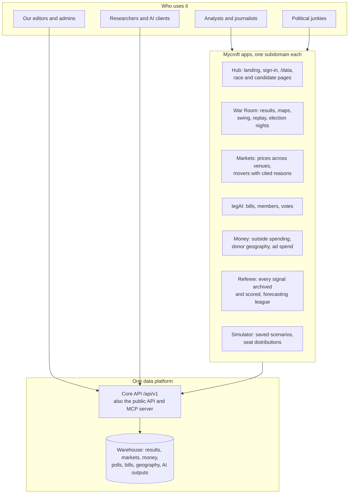

PLAN.md §5.6 already fixes the big shape: **one data platform, many thin apps**. No app gets its own backend or database, and every app reads the same versioned `/api/v1`, which is also the public API (#159).

### 2.2 The twelve workloads hidden in the backlog

A stack has to serve *kinds* of work, not features one at a time. So I sorted every issue by the kind of computing it needs:

| # | Workload | Driven by | What it asks of the stack |
|---|---|---|---|
| W1 | Interactive web apps | Every app screen, comparison mode #147, analyst map #157 | Fast single-page apps, maps (MapLibre), charts |
| W2 | Pages that search engines and social sites can read | Hub, object pages #156, AI race memos #152, share links and images #198, embeds #179 | HTML built on the server, social preview images, permanent URLs |
| W3 | One API for apps, researchers and AI | Read APIs #138, public API with keys #159, MCP server #183 | A versioned contract, an **OpenAPI** description, API keys, rate limits, caching |
| W4 | Live data | Kalshi and Polymarket feeds #178, election nights (2027 specials, 2028), alerts #168 | Long-lived connections, **fan-out** to many browsers, exactly one copy of each feed |
| W5 | Scheduled data syncs | FEC, FRED, EIA, Census, VoteHub, news, Congress.gov bills for legAI, ratings pages #175, ad libraries #182, certification #153 | Jobs that run on a timetable, retry, never overlap, and keep the raw payload |
| W6 | Time-series history | Price ticks #178, daily signal archive #175, replay #139, "as of" #179 | Append-only tables that grow forever, fast "value at time T" queries, compression |
| W7 | Analytics over the warehouse | Swing explorer #140, scorecard #141, query builder #154, analyst map #157, ask the data #165, money geography #181, CSV export #143 | Sums and averages over millions of rows in under a second, and safe ad-hoc queries |
| W8 | Statistical models | Forecast #149, Monte Carlo #150, what's still out #177 (with a backtest), clusters #170, impeachment math (PLAN §4.10) | Regression, simulation, Bayesian fitting, backtesting, versioned runs anyone can repeat |
| W9 | Geography as data | Redistricting lean #162, precincts #169 and #171, cartograms #157, money geography #181 | Spatial joins ("which precincts fall in new district 7?") and map tiles too big for a browser to load whole |
| W10 | AI features | Why it moved #166, race memos #152, ask the data #165, chat (PLAN §4.12), legAI summaries | LLM calls with tools, citations, review queues, run logs, search over articles and bill text |
| W11 | Accounts across apps | Accounts and workspaces #151, alerts #168, league #180, scenario studio #160 | One sign-in for every subdomain, roles, entitlements, API keys, email and push |
| W12 | Running it safely | Analytics, errors and uptime #193, backups #190, security #197 | Error reporting, alerts, cookieless analytics, tested restores |

### 2.3 Numbers that size the system

These are estimates. The assumptions are shown so you can redo them as you learn more.

| Thing | Today | By 2028 (estimate) | Basis |
|---|---|---|---|
| Main database | About 1 GB | 20 to 100 GB | PLAN §5.5: about 1 GB used of 5 GB. Growth comes mostly from ticks, precincts and itemized FEC money |
| Market price rows | About 22,000 a day (913 markets, hourly) | 36,000 to 3.6 million a day | About 1,800 markets in all (900 on each of two venues), each changing price 20 times a day in a quiet month and up to 2,000 times a day on election week |
| Tick storage per year | None | About 2 GB (quiet) to 100+ GB (busy), before compression | About 150 bytes a row with its index. TimescaleDB compression often shrinks this tenfold or more; measure on our data |
| Election-night results | About 1 million rows a night | The same per night, plus specials | `civicapi-results.md`, "Database size" |
| Signal archive (#175) | None | About 2 million rows a year | 470 races × about 10 signals × 365 days |
| Precinct results (#171) | None | A few million rows | Roughly 170,000 precincts nationally, but only the states #162 needs (PLAN §4.13) |
| Precinct shapes | None | Hundreds of MB to a few GB | Too big to ship as TopoJSON; needs vector tiles |
| Read API speed | Not measured | p95 at most 750 ms; replay loads in under 3 s | PLAN §4.3, #145 |
| Traffic | Hundreds to a few thousand visitors a day (a guess) | Spikes of 10 to 100 times that on election nights | Spikes should land on the CDN, not the database |

**What the numbers say:** none of this is "big data". One well-set-up Postgres with the right extensions holds all of it through 2028. The challenge is the **variety** of work (live feeds, time-series, maps, statistics, AI), not the size.

### 2.4 Rules that shape the architecture

PLAN.md §1 isn't only product policy. Each rule has a technical consequence:

| Rule | What it forces in the stack |
|---|---|
| Numbers come from code, not AI | Models and indexes live in tested, versioned code. AI reads stored numbers through tools and never produces them |
| Every number has a source and a time | Every row links to `DataSource`, `IngestionRun` and `RawArtifact`, and raw payloads are kept in a bucket |
| Results are append-only; corrections are new rows | Time-series storage and "as of" queries. History is never updated in place |
| Missing is not zero | Nulls and explicit status columns everywhere, model outputs included |
| Market prices are not forecasts | Prices and model outputs are stored and labelled separately |
| Privacy: no addresses, no vote intentions | Analytics without cookies or query strings, and no addresses in logs |
| Every module sits behind a flag | Feature flags in both the API and the apps |

---

## 3. What we have today, and whether it can cope

### 3.1 Today's architecture

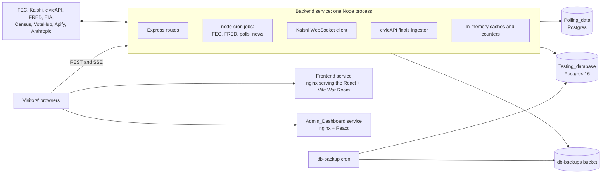

What's in it:

- **Code:** three independent npm projects in one Git repo. `CODE/` is the War Room (React 18, Vite, Tailwind, MapLibre). `admin-dashboard/` is the admin app. `backend/` is the API (Node 20, Express 4, Prisma 6, Zod, `node-cron`, `ws`).
- **Size:** 50 Prisma models, nearly 60 backend test files and more than 100 backend source files.
- **On Railway:** `Backend`, `Frontend`, `Admin_Dashboard`, two Postgres services, the `db-backup` cron and a bucket.
- **Known problems** from the Oct 29 security review that are about architecture: **H1** (no caching on hot endpoints), **H2** (multi-hour syncs inside the API process), **M3** (no alerting) and **M9** (one process owns the API, cron, WebSocket, SSE and all in-memory state).

### 3.2 A note on "monorepo"

You described the current choice as "the monorepo TypeScript". Two things are worth untangling:

- **What it is today:** one Git repo holding three *independent* npm projects. They share no workspace, packages or types. That's sometimes called a monorepo, but none of the monorepo tooling (pnpm workspaces, Turborepo) is in use.
- **What PLAN.md decided on Nov 10:** each new app gets its own repo, and this repo stays the core (API, War Room, admin).
- **Repo layout doesn't decide what the system can do.** One repo or many is about how code is organized and shared, not about what it can compute. This report takes the Nov 10 decision as given and only suggests where new code goes (§8.7).

### 3.3 Can today's stack handle each workload?

✅ fits as is · ⚠️ works, but needs changes · ❌ missing a capability

| Workload | Today | Why |
|---|---|---|
| W1 Interactive apps | ✅ | React, Vite, MapLibre and TanStack Query are a standard, strong choice |
| W2 Search and social pages | ⚠️ | A Vite app sends one empty HTML shell, so search engines and link previews see nothing. The Astro hub (PLAN §5.6) fixes this once it gets server rendering and preview images |
| W3 One API | ⚠️ | Express 4 works, but there's no OpenAPI description (§5.6 needs one to generate app clients), no API keys, and most routes send no cache headers (H1) |
| W4 Live data | ⚠️ | Works with one API replica. Two replicas would open two Kalshi sockets and show different prices (M9). Needs a `market-feed` worker and Redis |
| W5 Scheduled syncs | ⚠️ | The sync code is good, but it runs inside the API process (H2). Railway cron services and a job queue fix that |
| W6 Time-series | ❌ | Prices are hourly rows in a plain table, which is why the replay's price line is coarse (#139). Storing every tick needs partitioned, compressed storage |
| W7 Analytics | ⚠️ | Fine for fixed queries. Ad-hoc queries from a query builder or an AI would run on the production database. Prisma is built for reading and writing records, not for window functions and time buckets |
| W8 Statistical models | ❌ | Nothing in the JavaScript world comes close to Python's statistics tools (§5.1) |
| W9 Geography as data | ❌ | There's no PostGIS. Maps ship as TopoJSON files that the browser loads whole, and precinct shapes are too big for that |
| W10 AI | ✅ / ⚠️ | The Anthropic SDK in TypeScript is fine. Missing: a job queue for agent runs, and search over articles and bill text |
| W11 Accounts | ⚠️ | Three separate login systems (admin, researcher, and the planned chat accounts). Needs one identity with a cookie shared across subdomains (#151) |
| W12 Operations | ❌ | No error reporting, analytics or alerts (M3, #193). Backups are done (#190) |

### 3.4 The verdict

Of the 12 workloads, 2 fit, 6 need changes and 4 are missing a capability. But look at *why*:

- **Architecture problems** (W2, W3, W4, W5, W10, W11, W12) are fixed by splitting the process and adding the server-rendered hub, Redis, a queue, one sign-in system and monitoring. Any language would need the same changes.
- **Storage problems** (W6, W7, W9) are fixed by Postgres extensions (TimescaleDB, PostGIS) and a column-store engine for ad-hoc queries (DuckDB). Also language-neutral.
- **Language problems** (W8, and part of W9) are the only place TypeScript itself falls short. Fitting a forecast, estimating the outstanding vote, clustering counties and moving precinct votes into new districts are everyday work in Python and rare in TypeScript.

So the case for a better stack is real, but it's mostly a case for **better architecture and storage**, plus **Python for the models**. Rewriting the web apps or the API in another language would take months and close none of these gaps.

---

## 4. Architecture ideas, explained

This section teaches the ideas that the options in §6 are built from. Each idea ends with what it means for Mycroft.

### 4.1 Monolith, modular monolith, microservices

- **Monolith:** one program does everything. Today's `Backend` is one: the API, cron jobs, the Kalshi socket and the results ingestor share one process.
- **Modular monolith:** still one codebase, but split into clean modules (results, markets, money and so on). The same code can start as different *processes*: it runs as `api`, as a `worker` or as a cron job depending on its start command.
- **Microservices:** many small programs, each with its own codebase and usually its own database, talking to each other over the network.

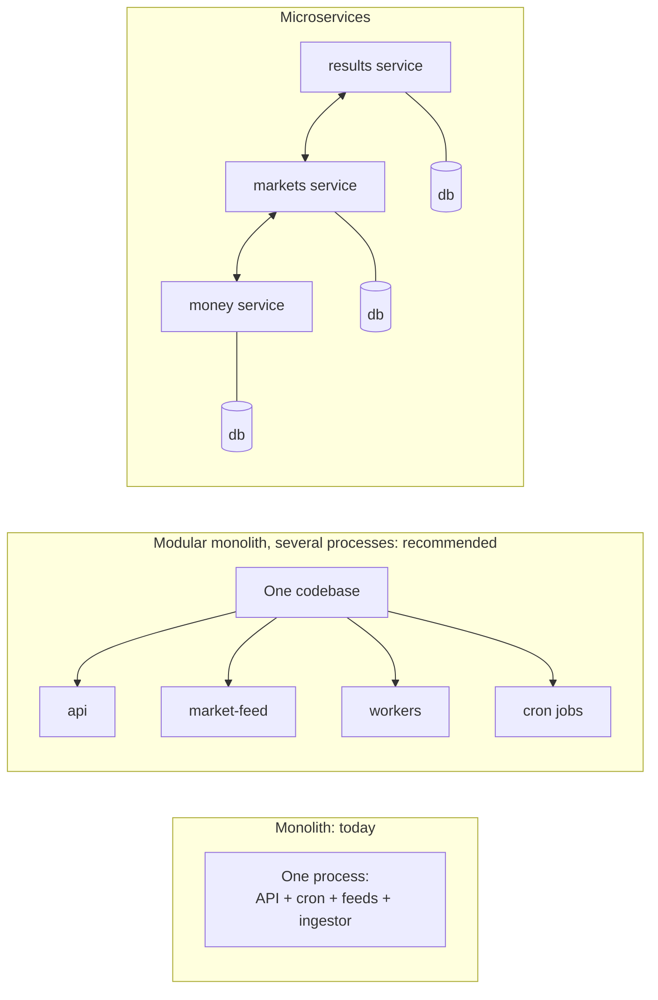

| | Pros | Cons |
|---|---|---|
| Monolith | Simplest to build and deploy | A slow job slows the website. You can't scale one part alone. One crash takes everything down |
| Modular monolith as several processes | One codebase with shared types and tests. Each process scales and fails on its own | Needs some discipline about module boundaries |
| Microservices | Separate teams can work fully independently | Many network calls, versions and deployments. Far too much for a team of one or two |

**For Mycroft:** a modular monolith running as several Railway services. PLAN §5.2 already sketches this (`api`, `market-feed`, `results-ingestor`, `cron-*`); it just hasn't been built.

### 4.2 Two kinds of database work: OLTP and OLAP

- **OLTP** (transaction processing) is "save this user's watchlist" or "get race PA-07": many small reads and writes of single rows. Postgres is excellent at it.
- **OLAP** (analytical processing) is "average swing by county type across 3,100 counties and 6 elections" or "outside spending by group across every race": fewer queries, each one scanning millions of rows.

The difference comes from how data sits on disk:

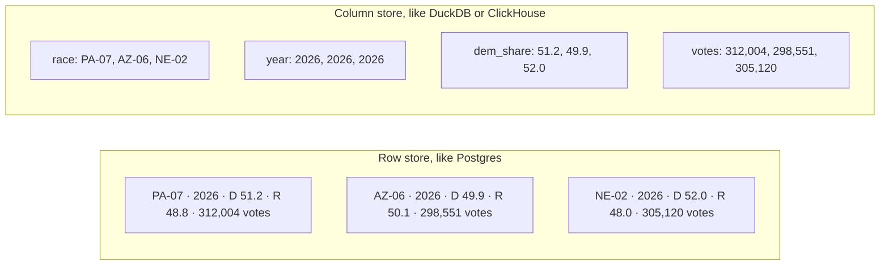

(Illustrative numbers.) A **row store** keeps each row together, which is ideal for fetching one race. A **column store** keeps each column together, so a query that needs 3 of 40 columns reads only those 3, and similar values next to each other compress well. Analytical queries often run 10 to 100 times faster.

**For Mycroft:** keep Postgres as the system of record. For ad-hoc analytics (the query builder, ask the data), export curated tables nightly as **Parquet** files and query them with **DuckDB**. That keeps heavy or AI-written queries away from the production database.

### 4.3 Time-series storage

Ticks, results snapshots and daily archives are **time-series**: rows that arrive in time order and are never changed. A plain table copes until it gets big. Then every insert updates huge indexes, and every "last 14 days" query wades through old data.

There are three ways to handle it:

1. **Native Postgres partitioning.** Split the table by month. Each month is its own chunk that can be indexed or archived separately. No extension needed, but you manage the partitions yourself.
2. **TimescaleDB.** A Postgres extension that partitions for you (**hypertables**), compresses old chunks into a column format, and keeps **continuous aggregates**: pre-computed 1-minute or 1-hour price bars that update themselves.
3. **A separate column-store database such as ClickHouse.** Fastest at very large scale, but it's a second database to run and keep in sync.

**For Mycroft:** TimescaleDB. Our biggest stream, ticks, is well within its range, and it's still Postgres, so Prisma, backups and plain SQL keep working.

### 4.4 Cron jobs, queues and long-running workers

| Pattern | In plain words | Good for | Watch out for |
|---|---|---|---|
| **Cron** | "Run this at 9:15 every day" | Syncs on a timetable | Railway cron runs at most every 5 minutes, in UTC, and won't start a run while the previous one is still going |
| **Queue** | "Here's a job; a worker should do it soon, and retry if it fails" | Work set off by an event: tag this article, explain this move, build this export | Jobs must be safe to run twice (**idempotent**) |
| **Long-running worker** | A process that stays connected and handles events as they arrive | Kalshi and Polymarket sockets, election-night ingestors | Exactly one copy must run, or data doubles |

**For Mycroft:** all three. Cron for syncs, a queue for AI agents and exports, and long-running workers for feeds. Today everything is cron inside the API.

### 4.5 Caching layers

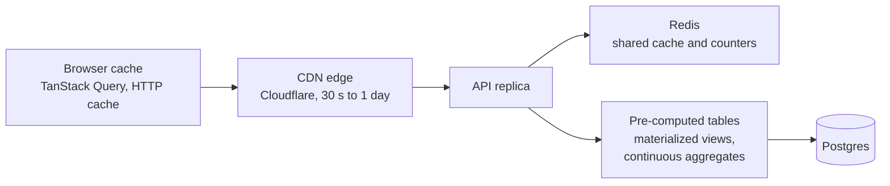

A request should be answered by the first layer that can answer it. Every layer it skips saves the database work. On election night, a 30-second CDN cache turns 10,000 identical requests into one database query.

**For Mycroft:** send `Cache-Control` on every public GET (H1), put Cloudflare in front, keep Redis for shared caches and counters, and pre-compute heavy aggregates.

### 4.6 Live updates: polling, SSE, WebSockets and fan-out

- **Polling:** the browser asks again every 30 seconds. Simple, and it caches well. Used today for election-night results.
- **Server-Sent Events (SSE):** one long HTTP response that the server keeps writing to. One way only (server to browser), and it passes through proxies. Used today for Kalshi prices.
- **WebSockets:** a two-way connection. Only needed when the browser streams data back, which ours doesn't.

The hard part isn't the browser side; it's **fan-out**. Exactly one process may hold the Kalshi socket, but many API replicas serve browsers. A **pub/sub** channel in Redis carries each price from the one feed process to every replica:

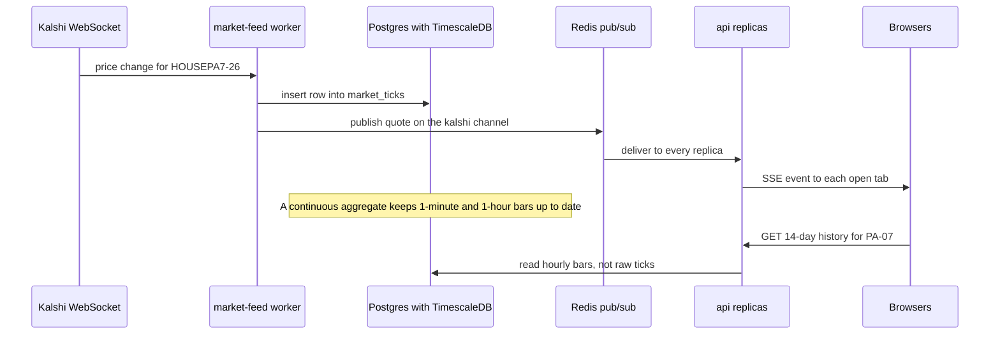

**For Mycroft:** keep SSE, and add the `market-feed` worker and Redis pub/sub that PLAN §5.2 already plans. With Cloudflare in front, send a heartbeat at least every 30 seconds, because Cloudflare closes proxied connections that stay silent for about 100 seconds.

### 4.7 Single-page apps, server rendering and static pages

| Approach | How it works | Good for | Weak at |
|---|---|---|---|
| **SPA** (Vite + React) | The server sends an empty page and a JavaScript bundle; the browser builds the page | Rich tools: maps, simulators, dashboards | Search engines and link previews see an empty page |
| **SSR** (server-side rendering) | The server builds the HTML on each request | Pages that must show up in search and previews | Needs a running server |
| **Static or incremental** | HTML is built ahead of time, or on the first request and then cached | 470 race memos, methodology pages | Must rebuild when data changes |
| **Islands** (Astro) | Mostly server or static HTML, with small interactive pieces | Content pages with a chart or map inside | Not meant for full apps |

**For Mycroft:** §5.6 already chose right. Apps stay Vite SPAs, and the hub is Astro with server rendering for object pages and memos. For share links (#198), add preview images: Satori turns a small HTML template into an image, so every shared link gets a card with the number, its source and its time.

### 4.8 Raw, clean, marts: the "medallion" pattern

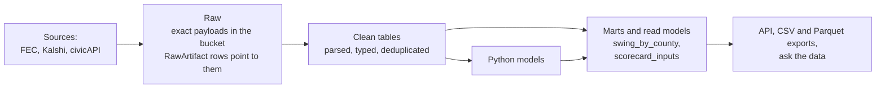

- **Raw:** the exact bytes a source sent, saved before parsing. You can re-parse after fixing a bug, and you can prove where a number came from.
- **Clean:** parsed, typed, deduplicated tables such as `candidates` or `result_snapshots`.
- **Marts:** tables shaped for one screen or question, such as `swing_by_county`. The results read model is already one.

**For Mycroft:** you already do most of this. The lock-2026 work found the gap: election-night civicAPI payloads went to the container's disk and were lost on redeploy. Results payloads now go to the bucket; every other source should do the same. Later, **dbt** (§5.6) can manage the clean-to-marts step as tested SQL.

### 4.9 Model runs anyone can repeat

A published model must be repeatable: the same inputs and the same code give the same output. The pattern:

1. Every run gets a row in `model_runs`: model name, version, git commit, a hash of the inputs, start and end times, and status.
2. The inputs are saved as a Parquet file in the bucket, so the run can be repeated later.
3. Outputs are written with the run's id, and nothing is overwritten.
4. A run is **published** by pointing to it, the same way results snapshots are published today.

This is `agent_runs` and `IngestionRun` applied to models, and it's what makes "numbers come from code" checkable by anyone.

### 4.10 Containers and serverless

- **Containers**, which Railway runs: your app in a box that runs as long as you like. Good for APIs, sockets and workers.
- **Serverless functions** (AWS Lambda, Cloudflare Workers): code that runs once per request and costs nothing when idle. Cheap for short, spiky work; awkward for long-lived sockets and long jobs.

**For Mycroft:** containers. Our feeds and jobs run for a long time. Serverless only fits at the edge, such as Cloudflare's caching rules.

---

## 5. The building blocks: each tool, with pros and cons

Verdicts: **Keep** (already used, still right), **Add**, **Later** (add when a trigger hits), **Skip**.

### 5.1 Languages

| | TypeScript | Python | R | Go |
|---|---|---|---|---|
| **What it is** | JavaScript with types; runs in browsers and on Node | The main language of data science | A language built for statistics | A fast compiled language for servers |
| **Strong at** | Web apps, APIs, live connections, one set of types from database to browser | Data tables, statistics, machine learning, geography, notebooks | Statistics and election modelling (Stan, brms) | Very high-traffic services |
| **Weak at** | Statistics and numeric work; geographic analysis | Browser apps; types are optional | General apps and APIs | Data science; another language to learn |
| **Libraries we'd use** | React, MapLibre, Zod, Prisma, Anthropic SDK | Polars, DuckDB, NumPy, SciPy, statsmodels, scikit-learn, PyMC, GeoPandas, tobler | brms, Stan | None needed |
| **Verdict** | **Keep** for everything people touch | **Add** for models and geography | **Skip**: Python covers it, with one language fewer | **Skip**: it fills no gap we have |

Why Python for models specifically:

- **Fitting.** statsmodels (regression), scikit-learn (clustering for #170) and PyMC or NumPyro (the Bayesian models that public election forecasters describe) have no real JavaScript equivalent.
- **Data wrangling.** Polars and pandas do joins, pivots and rolling windows in a few lines. JavaScript's options (Arquero, Danfo) are small and thinly used.
- **Geography.** GeoPandas and Shapely do spatial overlays, and **tobler** does areal interpolation, which is exactly "move precinct votes into new district lines" for #162.
- **Method pages.** Notebooks (Jupyter or marimo) let the methodology page show the real code that produced a number.

An honest caveat: the Monte Carlo *simulation* itself is easy in TypeScript. The existing simulators already do seat math in the browser, and 10,000 runs over 470 races is a few million random draws, which takes well under a second. The hard part is *estimating the correlations* to feed it (how much districts' errors move together), and that's where Python earns its place.

### 5.2 Web frontends

| Tool | What it is | Pros | Cons | Verdict |
|---|---|---|---|---|
| **React + Vite** | The War Room's framework and build tool | Fast builds, huge ecosystem, already working | SPA only, so no search or link previews | **Keep** for apps |
| **Astro** | A site framework that renders HTML on the server with interactive "islands" | Great for search, fast pages, can embed React components | Not built for full apps | **Keep** for the hub (already chosen in §5.6) |
| **Next.js** | React with server rendering built in | One framework for apps and pages | Heavier; more moving parts; most at home on Vercel | **Skip**: Astro and Vite cover both needs |
| **MapLibre** | The map library in use | Free, fast, vector maps | Big layers need tiles | **Keep** |
| **PMTiles + tippecanoe** | A tool that cuts huge shape files into map tiles, stored as one file read in pieces | Lets precinct maps load quickly; no tile server needed | One build step per map | **Add** with #162 and #171 |
| **Satori** | Turns a small HTML and CSS template into an image | Share cards (#198) that carry the source and time | One more thing to render | **Add** with #198 |

### 5.3 API frameworks

| Framework | What it is | Pros | Cons | Verdict |
|---|---|---|---|---|
| **Express 4** (today) | The classic Node web framework | Everyone knows it; it works | Doesn't catch errors from `async` handlers (the code works around this in `server.ts`); no built-in schemas | Upgrade |
| **Express 5** | The current Express | Same code style; passes `async` errors to the error handler | Still no schema or OpenAPI support built in | **Add**: the low-risk upgrade |
| **Fastify** | A faster framework built around schemas | Schemas and OpenAPI built in; fast | Different plugin style; routes must be ported | Later, if speed matters |
| **Hono** | A small framework built on web standards | `@hono/zod-openapi` turns Zod schemas into OpenAPI; runs anywhere | A rewrite of routes | Possible for new, separate services such as `mcp` |
| **FastAPI** (Python) | Python's most popular API framework | OpenAPI built in; Pydantic schemas | A full backend rewrite (§6, Option C) | **Skip** for the API |

The OpenAPI description that §5.6 needs doesn't require a new framework. Zod 4, which the backend already uses, can produce JSON Schema itself (`z.toJSONSchema()`), and libraries such as `zod-to-openapi` assemble the full OpenAPI file from it. Check Zod 4 support in whichever library version you pick.

### 5.4 Talking to the database

| Tool | What it is | Pros | Cons | Verdict |
|---|---|---|---|---|
| **Prisma** (today) | An ORM: write TypeScript, it writes SQL | Easy reads and writes; migrations; typed results | Clumsy for analytical SQL; TimescaleDB setup needs hand-written SQL inside migrations | **Keep** for records and as the only owner of migrations |
| **Prisma TypedSQL** | Write a `.sql` file, get a typed function (a preview feature) | Real SQL for analytics, still typed | Preview status | **Add** for analytics queries |
| **Kysely** | A typed SQL query builder | Full SQL power with types | A second way to query | Alternative to TypedSQL |
| **Drizzle** | A lighter, SQL-like ORM | Close to SQL; fast | Migrating off Prisma is a lot of work for little gain | **Skip** |
| **psycopg + Polars** (Python) | Python's Postgres driver and data-table library | Fast bulk reads and `COPY` writes | Python must never run migrations | **Add** with the Python layer |

### 5.5 Databases and storage

| Tool | What it is | Pros | Cons | Verdict |
|---|---|---|---|---|
| **PostgreSQL** | The relational database in use | Reliable; does almost everything; extensions add the rest | One server; heavy analytics compete with app traffic | **Keep** as the system of record |
| **TimescaleDB** | Postgres extension for time-series | Hypertables, compression, continuous aggregates; still plain SQL | Generally not offered by AWS's or Google's managed Postgres (§7.2); backups need its restore steps (§10) | **Add** for ticks, snapshots and the archive |
| **PostGIS** | Postgres extension for geography | The standard for spatial queries | Learning curve for spatial SQL | **Add** for #162, #171, #181 |
| **pgvector** | Postgres extension for embeddings (meaning-based search) | Search articles and bill text by meaning, for cited AI answers | Embeddings cost money to compute | **Add** when legAI and #166 need it; try Postgres full-text search first |
| **DuckDB** | A column-store database that runs inside your program and reads Parquet | Very fast analytics with no server; safe sandbox for ask the data | Not a shared, live database | **Add** for the query builder and ask the data |
| **ClickHouse** | A column-store database server | Fastest at billions of rows | A second database to run and keep in sync | **Later**, only past the triggers in §7.5 |
| **BigQuery** | Google's managed warehouse | No servers; pay per query | Costs grow with data scanned; outside Railway | **Later**, as a hybrid option |
| **Redis** | An in-memory store | Pub/sub fan-out, shared counters, locks, cache | Memory only, never the source of truth | **Add** (already planned in §5.2) |
| **Railway Buckets** | S3-compatible file storage | Cheap; free downloads and API calls | Not on Railway's private network; uploads from services count as egress | **Keep** for raw payloads, Parquet, exports and tiles |

Why one Postgres with three extensions rather than several databases: every app joins results, money, markets and geography together. That's easy in one database and painful across several. Polls live in their own database today only because the old volume was small (PLAN §5.5); with today's larger Railway volumes they can move back into the main database as a separate schema.

### 5.6 Jobs and pipelines

| Tool | What it is | Pros | Cons | Verdict |
|---|---|---|---|---|
| **Railway cron services** | Railway starts a container on a timetable | Nothing to install; each job is isolated | 5-minute minimum; times in UTC; no retries or history UI | **Add** (planned in PLAN §5.3) |
| **pg-boss** | A Node job queue stored in Postgres | No new service; jobs are backed up with the database | Postgres load at very high volume | **Add** for TypeScript workers |
| **BullMQ** | A Node job queue on Redis | Fast; good dashboard | Jobs live in Redis, which isn't the source of truth | Alternative to pg-boss |
| **Trigger.dev or Inngest** | Hosted "durable functions" with retries and a UI | Great visibility | Another vendor, or another service to host | **Later**, if job count explodes |
| **Temporal** | A workflow engine for long, multi-step processes | Very robust | Heavy to run and learn | **Skip** |
| **Dagster** | A Python orchestrator that tracks data assets and lineage | Shows what depends on what; schedules; backfills | Two or three more services; a learning curve | **Later**, when there are 10+ linked pipelines |
| **dbt** | Turns SQL files into tested, documented tables | Tests such as "never null" and "unique"; lineage docs | Another tool and folder | **Later**, for marts in Phase 3 or 4 |

### 5.7 Accounts

| Option | What it is | Pros | Cons | Verdict |
|---|---|---|---|---|
| **Build it ourselves** (today's pattern) | Hashed session tokens, as in `AdminSession` | Full control; no vendor | Every feature (API keys, roles, cross-subdomain cookies) is hand-built and must be secured | Possible, but the most work |
| **Better Auth** | An open-source TypeScript auth library | Data stays in our Postgres; Google sign-in; plugins for API keys and organizations; cookies shared across subdomains | A library to learn and keep updated | **Add**: best fit for #151 and #159 |
| **Clerk, WorkOS or Auth0** | Hosted sign-in services | Fastest to set up; polished screens | User data lives with a vendor (a weaker fit for the privacy rules); cost grows per user | **Skip** |

### 5.8 Running it: edge, monitoring, email

| Tool | What it is | Pros | Cons | Verdict |
|---|---|---|---|---|
| **Cloudflare** (free plan) | DNS, CDN, DDoS protection, firewall | Absorbs election-night spikes; free | JSON responses aren't cached until you add a Cache Rule; idle connections close after about 100 s | **Add** |
| **Sentry** | Error reporting for browser and server | Release tags, stack traces | A third-party service; scrub URLs (privacy rules) | **Add** for #193 |
| **Umami or Plausible** | Cookieless page analytics | No cookies; query strings can be dropped | Umami is self-hosted (one more small service); Plausible is paid or self-hosted | **Add** for #193 |
| **An uptime checker** (Better Stack, UptimeRobot) | Pings the site and alerts you | Tells you when the site is down | None worth noting | **Add** for #193 |
| **Postmark or Resend** | Email delivery | Reliable alert emails for #168 | A small vendor dependency | **Later**, with #168 |

### 5.9 AI layer

| Piece | Verdict |
|---|---|
| Anthropic SDK in TypeScript, behind one provider interface (PLAN §4.12) | **Keep** |
| Agents run as queue jobs, each logged in `agent_runs` | **Add** (needs the queue) |
| Admin review queue before anything about a named person publishes | **Keep** (PLAN §4.2, rule 5) |
| MCP server built with the official TypeScript MCP SDK, wrapping the public API (#183) | **Add**, after #159 |
| Search over articles and bills: Postgres full-text search first, pgvector when meaning-based search is needed | **Add** step by step |

---

## 6. Four stack options

All four keep React, Vite and Astro for the frontends, because those are already right. They differ in the backend, storage and models.

### Option A: TypeScript all the way, upgraded

**The idea:** fix the architecture and storage, but keep one language. Models are written in TypeScript.

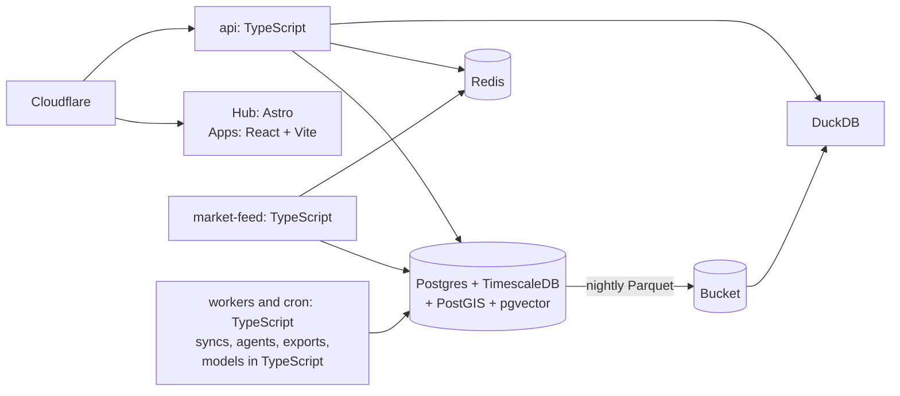

**What changes:** split `Backend` into `api`, `market-feed`, `workers` and cron services (same code, different start commands); add Redis and pg-boss; move to Postgres with TimescaleDB, PostGIS and pgvector; add DuckDB for analytics; add Better Auth, Cloudflare and Sentry; write models with small JavaScript statistics libraries and SQL.

| Pros | Cons |
|---|---|
| One language, one toolchain, one set of tests | Statistical methods would be hand-written, which is risky for a model whose methodology we publish |
| Types shared from the database to the browser | No notebooks for method pages; geography only through PostGIS SQL |
| Least to learn, and the cheapest to run | Harder to bring in a data scientist or a collaborator from academia |
| No new language in CI | #149, #177 and #170 become much bigger jobs |

**Effort:** M to L, spread over several months. **Best if:** you postpone or simplify the modelling issues (#149, #177, #170, #162).

### Option B: TypeScript product, Python models (recommended)

**The idea:** Option A, plus a small Python layer that does only models and geographic processing. Python reads from the database and writes results back; it never serves users directly.

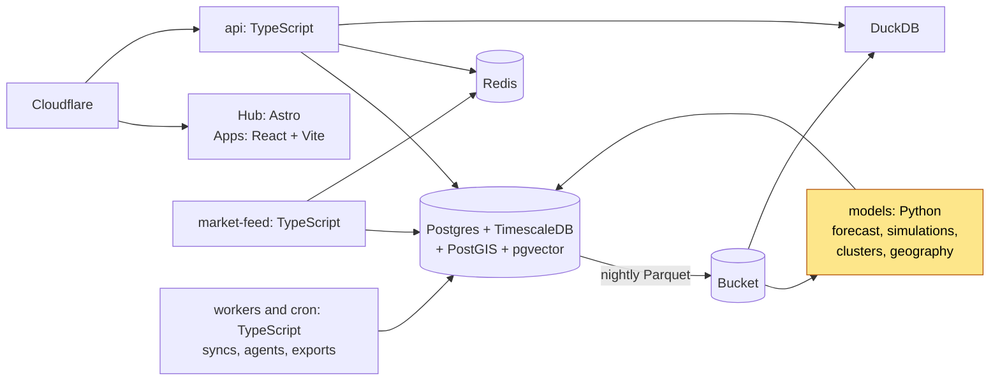

**What changes:** everything in Option A, plus a `models/` Python project (§8.7) that runs as Railway cron services and writes to `model_*` tables with a `model_runs` log (§4.9).

| Pros | Cons |
|---|---|
| The best tool for each job: TypeScript for product, Python for numbers | Two languages, two dependency tools, two test suites |
| No rewrite: every working TypeScript feature stays | A contract between them to keep in sync (§8.6) |
| Python is the common language of election modelling, so methods, libraries and collaborators are easy to find | A little more to deploy (one more Docker image) |
| Notebooks can back the methodology pages | |
| The Python layer starts small and grows only as models arrive | |

**Effort:** Option A's effort, plus S to M to set up Python; each model is then smaller than in Option A. **Best if:** the forecast, the referee, the still-out model and redistricting are part of the plan, as PLAN §4.13 and §4.14 say they are.

Option B is Option A plus one addition. So it's a low-regret path: do Option A's upgrades first (every option needs them), and add the Python layer when the first model issue starts.

### Option C: Python-first backend

**The idea:** rewrite the API and workers in Python (FastAPI, SQLAlchemy, Celery or Arq). Frontends stay in TypeScript.

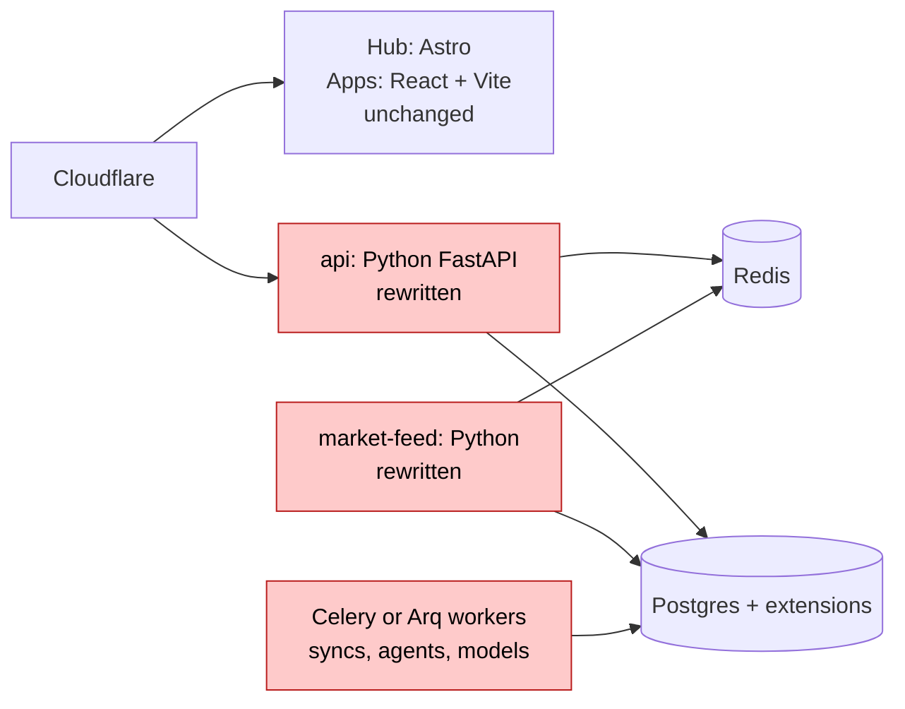

| Pros | Cons |
|---|---|
| One backend language, the same as the models | Rewrites a working, tested backend: 50 models, nearly 60 test files, the results pipeline that ran on election night, the Kalshi socket and every sync |
| FastAPI produces OpenAPI on its own | Months of work with no new features to show for it |
| Pydantic schemas | Frontend and backend no longer share types (they'd be generated from OpenAPI) |
| | PLAN §5.6 retired legAI's FastAPI backend for good reasons, and they still hold |

**Effort:** L to XL. **Best if:** you were starting from nothing with a data-science team. You aren't.

### Option D: Full data platform

**The idea:** separate the app database from an analytics warehouse, and add a proper orchestrator and transformation layer.

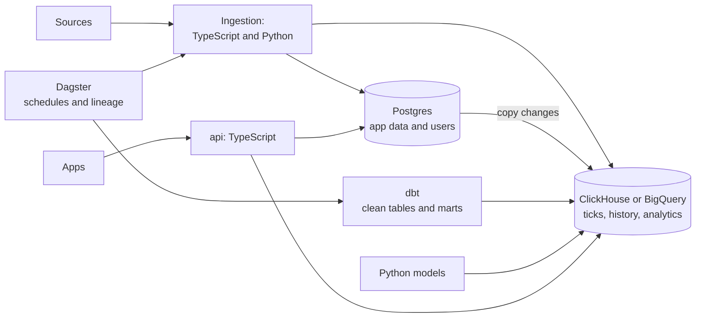

| Pros | Cons |
|---|---|
| Scales to billions of rows | Three or four more systems to run, watch and pay for |
| Lineage and asset views for every table | Data is copied between databases, and copy bugs make the two disagree |
| Analysts can explore without touching the app database | The steepest learning curve of the four |
| | Solves a scale problem we don't have yet (§2.3) |

**Effort:** XL. **Best if:** the triggers in §7.5 hit. Option B grows into Option D one piece at a time if that day comes.

### 6.5 Side by side

| | Today | A: TypeScript upgraded | **B: TypeScript + Python** | C: Python-first | D: Data platform |
|---|---|---|---|---|---|
| Covers the backlog | ★★ | ★★★ | ★★★★★ | ★★★★ | ★★★★★ |
| Easy for a beginner | ★★★★★ | ★★★★ | ★★★ | ★★★ | ★ |
| Little to run and watch | ★★★★ | ★★★★ | ★★★★ | ★★★★ | ★★ |
| Keeps working code | n/a | ★★★★★ | ★★★★★ | ★ | ★★★★ |
| Monthly cost | ★★★★★ | ★★★★ | ★★★★ | ★★★★ | ★★ |
| Room to grow to 2028 | ★ | ★★★ | ★★★★ | ★★★★ | ★★★★★ |
| Time to first value | n/a | Weeks | Weeks | Months | Months |

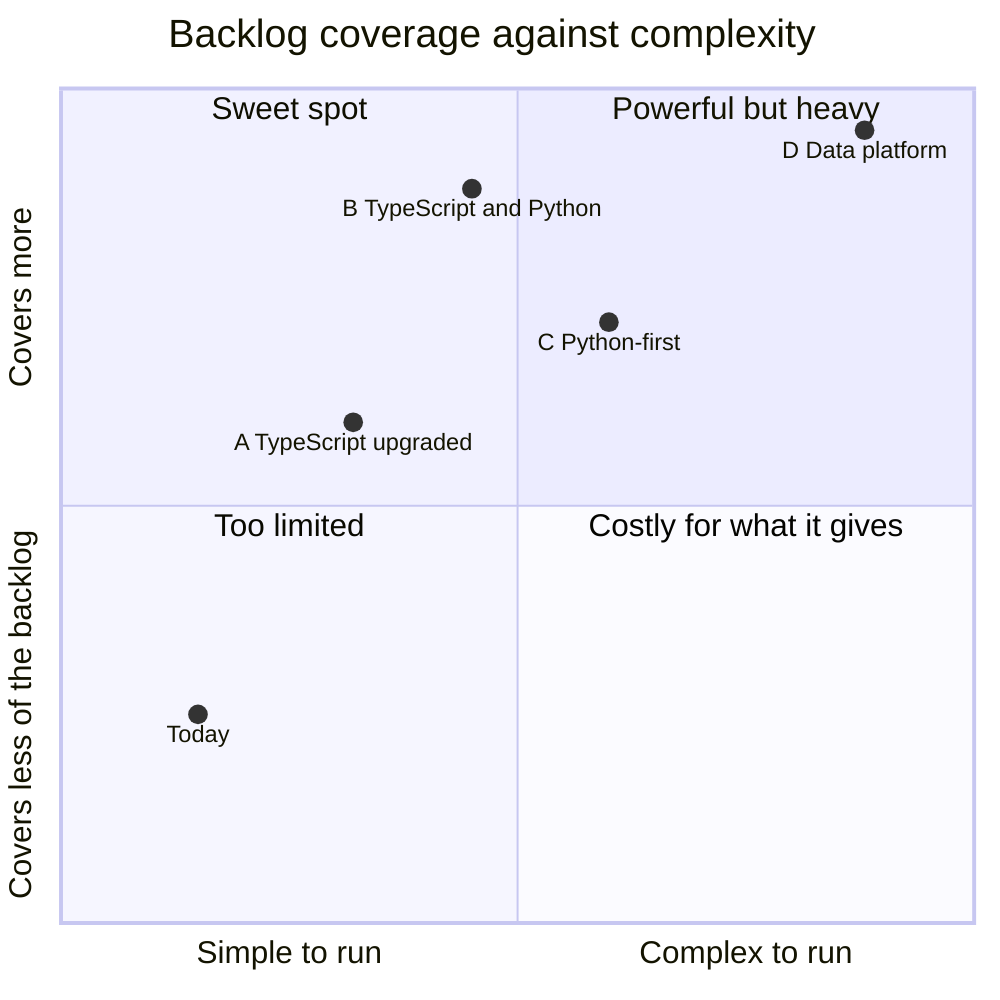

---

## 7. Where to run it: Railway, AWS or Google Cloud

### 7.1 What Railway gives us

Checked Nov 16, 2026 against Railway's documentation (links in §13). Prices and limits change, so recheck before relying on them.

| Need | Railway today |
|---|---|
| Containers for apps, the API and workers | Services with replicas, private networking, deploys on push |
| Pricing | About $20 per vCPU-month and $10 per GB of RAM a month, billed per second of actual use. Volumes about $0.15 per GB-month. Pro has a $20 monthly minimum that includes $20 of usage |
| Database size | Pro volumes start at 50 GB. The docs say Pro can grow them itself to 1 TB (an older page says 250 GB) |
| Scheduled jobs | Cron services. At most every 5 minutes, in UTC, and a run won't start while the last one is still going |
| File storage | Buckets: S3-compatible, about $0.015 per GB-month, with free downloads and API calls. Not on the private network, and uploads from services count as egress |
| High-availability Postgres | A Patroni-based option that converts an existing Postgres service. It launched in March 2026 as an early-access feature; check whether it's generally available and whether it works with a custom image |
| Postgres with extensions | Any Docker image runs, and there are TimescaleDB + PostGIS templates. Whether the stock Postgres image includes PostGIS or pgvector isn't documented, and forum reports conflict |
| ClickHouse, if ever needed | Community templates and a Railway guide |

### 7.2 The same architecture on AWS and Google Cloud

| Piece | Railway | AWS | Google Cloud |
|---|---|---|---|
| API, workers, frontends | Services | ECS on Fargate | Cloud Run services |
| Scheduled jobs | Cron services | EventBridge Scheduler plus ECS tasks or Lambda | Cloud Scheduler plus Cloud Run jobs |
| Postgres + TimescaleDB + PostGIS | Any image or template | RDS and Aurora offer PostGIS and pgvector but not TimescaleDB; you'd self-host on EC2 or use Timescale's own cloud | Cloud SQL and AlloyDB offer PostGIS and pgvector but not TimescaleDB; same choice |
| Redis | Redis service | ElastiCache | Memorystore |
| File storage | Buckets | S3 | Cloud Storage |
| Queue | pg-boss inside Postgres | SQS | Pub/Sub or Cloud Tasks |
| CDN | Cloudflare | CloudFront | Cloud CDN |
| Analytics warehouse | DuckDB over Parquet | Athena or Redshift | BigQuery |
| Secrets | Service variables | Secrets Manager | Secret Manager |

Check each provider's current extension list before deciding; the TimescaleDB row is the one most likely to matter.

### 7.3 Pros and cons

| | Railway (+ Cloudflare) | AWS | Google Cloud |
|---|---|---|---|
| **Pros** | Simplest by far. Runs any Docker image, so TimescaleDB is easy. You already know it, and its tools are in this session. Per-second billing. Private networking between services | Every building block exists. Scales to anything. The most mature | Cloud Run is the easiest big-cloud way to run containers. BigQuery is an excellent warehouse. Generous free tiers |
| **Cons** | A smaller company. Fewer managed building blocks (no managed queue or warehouse). HA Postgres is new. 5-minute cron minimum | The steepest learning curve: IAM permissions, VPC networking, NAT. Fixed costs before any app runs (a NAT gateway and a load balancer alone are roughly $50 a month). No managed TimescaleDB | Still IAM and networking to learn. BigQuery charges by data scanned, so public-facing queries need care. No managed TimescaleDB |
| **Fits Mycroft now?** | **Yes** | No: too much to operate for one or two people | Not now; BigQuery is worth adding later as a hybrid |

### 7.4 Recommendation

**Railway, with Cloudflare in front**, plus a few small managed services where they're clearly better: Sentry for errors, an uptime checker, and an email sender when alerts arrive.

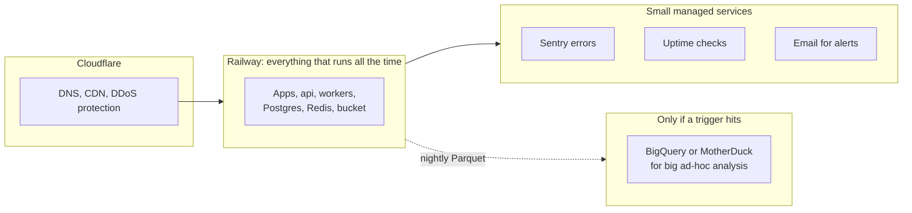

### 7.5 Signs it's time to add a big cloud, or move

- Postgres passes about 300 GB, or analytics push the read API's p95 past 750 ms even with marts and caching.
- We want full order books or every trade across venues, which is billions of rows a year.
- Railway has an outage on an election night, or a partner needs a contractual uptime guarantee.
- A data collaborator needs warehouse-scale ad-hoc analysis. Then add BigQuery or MotherDuck for the warehouse only, fed by the nightly Parquet files, and keep the apps on Railway.
- The team grows past about three engineers working on infrastructure.

---

## 8. The recommended architecture in detail

### 8.1 The whole picture

It's easiest to see in two halves: what happens when someone visits, and what runs in the background whether or not anyone visits.

**When someone visits.** Everything enters through Cloudflare. Browsers load an app or a hub page, and the page then calls the API.

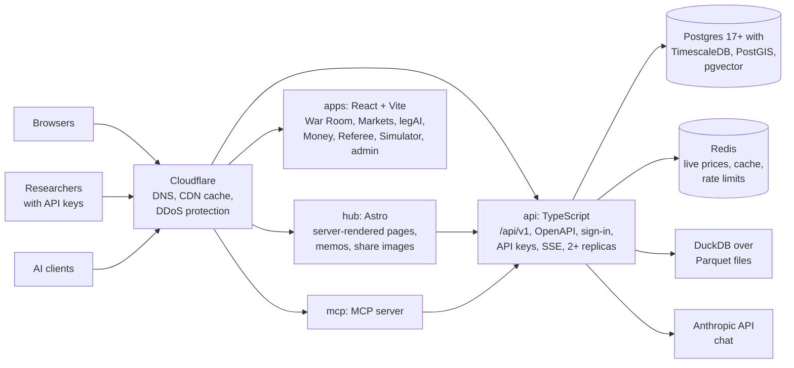

**In the background.** Feeds, syncs, workers and models fill the database. The Python model jobs (yellow) only read inputs and write versioned outputs.

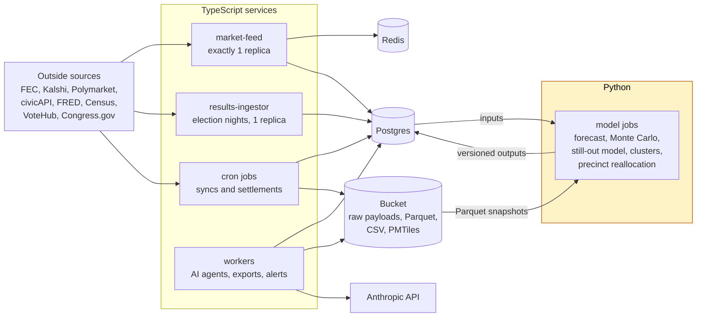

### 8.2 Railway services

| Service | Language | Replicas | What it does | New or existing |
|---|---|---|---|---|
| `hub` | TypeScript (Astro) | 1+ | Landing, sign-in, `/data`, object pages, memos, share images | Exists as `Landing_page_suite`; grows |
| `warroom`, later `markets`, `legai` and the rest | TypeScript (Vite) | 1 | Each app, served as static files | `Frontend` today |
| `admin` | TypeScript (Vite) | 1 | Admin, review queues, certification entry | Exists |
| `api` | TypeScript | 2+, more on election nights | `/api/v1`, auth, API keys, SSE | `Backend`, slimmed |
| `mcp` | TypeScript | 1 | MCP server over the public API (#183) | New, after #159 |
| `market-feed` | TypeScript | **Exactly 1** | Kalshi and Polymarket sockets, writes ticks, publishes to Redis | New (planned in §5.2) |
| `results-ingestor` | TypeScript | **Exactly 1**, election nights | civicAPI polling | Today inside `Backend` |
| `workers` | TypeScript | 1 to 2 | pg-boss jobs: AI agents, exports, alerts | New |
| `cron-*` | TypeScript | Run and exit | FEC, FRED, EIA, Census, polls, news, bills, settlements | Today inside `Backend` |
| `model-*` | Python | Run and exit | Model runs written to `model_*` tables | New |
| `db-backup` | Shell | Run and exit | Nightly verified dumps | Exists (#190); update for TimescaleDB (§10) |
| `postgres` | | 1 (HA later) | Postgres with TimescaleDB, PostGIS and pgvector | Replaces `Testing_database` and `Polling_data` |
| `redis` | | 1 | Pub/sub, cache, rate limits, locks | New (planned in §5.2) |
| `bucket` | | | Raw payloads, Parquet, exports, tiles, images | Exists |

### 8.3 How TypeScript and Python share one database

Two languages working on one database need clear rules, or they'll drift apart:

1. **Prisma migrations are the only thing that changes the schema.** Python never creates or alters tables.
2. **Python gets two database roles:** one that can read everything it needs, and one that can write only to `model_*` tables.
3. **Shared shapes are generated, not copied.** Zod schemas produce JSON Schema (`z.toJSONSchema()`), and a CI step turns that into Pydantic models (for example with `datamodel-code-generator`). If they disagree, CI fails.
4. **Python never serves users.** The TypeScript API reads the published model outputs and serves them.
5. **A contract test** in CI runs a small model job on fixture data and checks that the API's Zod schemas accept its output.

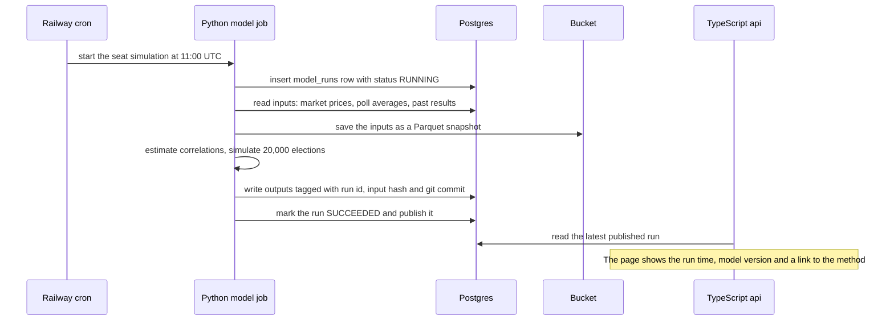

### 8.4 Ask the data, safely

Ask the data (#165) lets an AI write SQL. That SQL must never touch the production database or private tables (users, chats, sessions). The safe design runs it in DuckDB over public Parquet files:

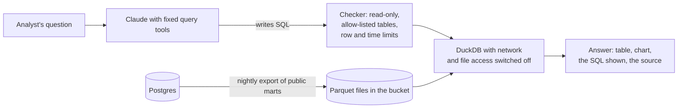

The same Parquet files serve as bulk downloads on `/data` (#144), the query builder (#154), and inputs to the Python models.

### 8.5 Storage choices inside Postgres

| Data | Table type | Why |
|---|---|---|
| Price ticks (#178) | Hypertable, compressed after 7 days, with 1-minute and 1-hour continuous aggregates | Can't be backfilled, so keep everything, compressed. Charts read the aggregates |
| Results snapshots, candidate votes | Hypertable | Append-only, and replay and "as of" read by time |
| Daily signal archive (#175) | Plain table, or a hypertable once it's large | Small; one row per race, signal and day |
| Precinct and district shapes | PostGIS geometry columns with spatial indexes | Spatial joins for #162 |
| Model outputs | Plain tables keyed by run id | Small; versioned through `model_runs` |
| Article and bill text | Full-text index first, then a pgvector column | Cited AI answers |
| Users, sessions, API keys, workspaces | Plain tables | Classic OLTP |

"As of" time travel (#179) needs no special database: because history is append-only, "as of Nov 5" is "the newest row with a time at or before Nov 5".

### 8.6 What each new piece costs (rough)

Steady state, outside election nights, at Railway's listed rates (§7.1). Railway bills actual use, so treat these as ranges and compare them with the real usage page after each phase.

| Piece | Rough monthly cost |
|---|---|
| `api` (2 replicas, light load) | $15 to $30 |
| `market-feed`, `workers`, TypeScript cron jobs | $10 to $25 |
| Python model jobs (short daily runs) | $2 to $10 |
| Postgres with extensions (1 to 2 GB RAM, 50 GB volume) | $25 to $45 |
| Redis | $2 to $5 |
| Frontends and the hub | $5 to $15 |
| Bucket (50 to 100 GB) | $1 to $2 |
| Egress, mostly absorbed by Cloudflare | $5 to $20 |
| **Total** | **About $65 to $150 a month**, plus Anthropic usage |

Election nights add temporary `api` replicas for a few hours. Cloudflare's free plan, Sentry's free tier and a free uptime checker cover the rest at our size. Option A costs about the same; Option D would add roughly $40 to $100 a month for ClickHouse and Dagster.

### 8.7 Where the new code goes

The Nov 10 decision (one repo per app) stays. The core repo gains a Python folder, because the models share this repo's database schema and migrations:

```text
Mycroft_elections_analysis/          core repo
├── backend/                         TypeScript: api, workers, cron and feed entry points
│   ├── prisma/                      the database contract: the only place migrations live
│   └── src/
│       ├── server.ts                api only, with no scheduler or feeds inside
│       ├── workers/                 market-feed, results-ingestor, queue workers
│       └── jobs/                    one file per cron job
├── models/                          NEW: Python (uv project)
│   ├── pyproject.toml
│   ├── mycroft_models/
│   │   ├── runs.py                  model_runs bookkeeping, shared by every model
│   │   ├── seats/                   #150 Monte Carlo
│   │   ├── still_out/               #177, with its backtest
│   │   └── redistricting/           #162 precinct reallocation
│   ├── notebooks/                   method pages (marimo or Jupyter)
│   └── tests/
├── CODE/                            War Room (React + Vite)
└── admin-dashboard/
```

Python tooling, kept small: **uv** (installs packages and pins versions), **ruff** (lint and format), **pytest**, **Polars** and **DuckDB** for data, **NumPy**, **SciPy** and **statsmodels** for statistics, **scikit-learn** for clustering, **GeoPandas**, **Shapely** and **tobler** for geography, and **PyMC** only when the forecast needs a Bayesian model.

---

## 9. Migration plan

The rule: **the launch comes first, and nothing is rewritten**. Each phase leaves the site working, and every step is reversible.

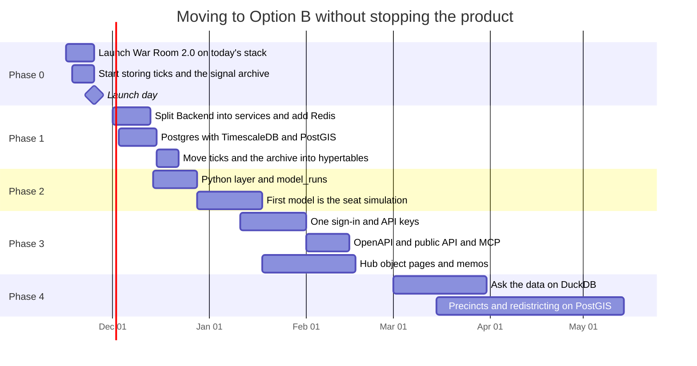

**Phase 0, now to Nov 25: launch on today's stack.** No stack changes. Only the launch items that are also good architecture:
- #193: Sentry, cookieless analytics and an uptime check.
- #192: once the domain is chosen, point its DNS through Cloudflare.
- The storage part of #178 and the daily archive of #175, which PLAN.md (Nov 14) starts in launch week because neither can be backfilled. Use ordinary Postgres tables, partitioned by month if you like. Phase 1 moves them into hypertables without losing a row.
- *Done when:* the launch ships, errors show up in Sentry, stopping the API sends an alert, and ticks and the daily archive are being stored.

**Phase 1, December: split the process and upgrade the database.**
- Run the same `backend/` code as `api`, `market-feed`, `results-ingestor`, `workers` and cron services. Add Redis for pub/sub and rate limits. This closes H2 and M9.
- Stand up Postgres with TimescaleDB, PostGIS and pgvector beside the old database. Rehearse the move with a dump and restore, then switch `DATABASE_URL`. Keep the old database read-only for two weeks.
- Move the tick table (#178) and the signal archive (#175) from Phase 0 into hypertables, and add compression and the 1-minute and 1-hour continuous aggregates.
- *Done when:* `api` runs two replicas with one Kalshi socket, ticks are landing in a compressed hypertable, and a restore of the new database has been proven.

**Phase 2, mid-December to January: the Python layer.**
- Create `models/` with uv, a Docker image, CI (ruff, pytest) and the `model_runs` table.
- First model: correlations for the Monte Carlo seat simulation (#150), which fills the "Coming soon" tipping-point panels. Calibration for the scorecard (#141) is a good small second.
- Start the nightly Parquet export to the bucket.
- *Done when:* a scheduled Python run writes a published, versioned result that the War Room shows with its run time and method link.

**Phase 3, January to February 2027: the suite foundation.** These are PLAN §5.6 steps 2 and 3.
- One sign-in system (Better Auth) with a cookie on the parent domain (#151), and API keys (#159).
- An OpenAPI description of `/api/v1`, generated from Zod, with app clients generated from it.
- Server-rendered object pages and race memos on the hub (#156, #152), then the MCP server (#183).
- *Done when:* one sign-in works across two subdomains, and a researcher can call the API with a key.

**Phase 4, spring 2027: the analyst tools.**
- Ask the data on DuckDB over Parquet (#165), then the query builder (#154).
- Redistricting (#162): new district shapes and precinct results in PostGIS, reallocation in Python, and maps as PMTiles.
- Consider dbt for the marts once there are more than a handful.
- *Done when:* "which Biden-to-Trump counties swung back in 2026?" is answered with the SQL and the source shown, and one state's new map shows its recomputed lean.

---

## 10. Risks

| Risk | How likely | What to do about it |
|---|---|---|
| Data is lost or changed during the database move | Low, if rehearsed | Rehearse with the `db-backup` dumps. Compare row counts per table, as `db-backup` already does. Keep the old database read-only for two weeks |
| TimescaleDB backups don't restore | Medium, if `db-backup` is left unchanged | Restoring a TimescaleDB dump needs `timescaledb_pre_restore()` before and `timescaledb_post_restore()` after, must not use `pg_restore -j`, and should use the same TimescaleDB version on both sides. The throwaway restore check in `ops/db-backup/` must use the same image |
| A community database image stops being maintained | Medium | Pin an exact image tag. Build from Timescale's official `timescaledb-ha` image, which includes PostGIS and pgvector (confirm on the tag's notes), rather than an unknown template. Test upgrades in staging |
| Railway's HA Postgres doesn't support the custom image | Medium | Rely on the verified nightly dumps and volume backups (#190). Accept a few minutes of downtime on a failure. Revisit before 2028's election nights |
| Two languages slow down one developer | Medium | Python only for models, with one CI pipeline and the contract test (§8.3). Each Python job is small and isolated |
| AI-written SQL leaks private data or overloads the database | Low with §8.4's design | DuckDB over public Parquet only, with network and file access switched off and time and row limits |
| Tick storage grows faster than expected | Low | Compression plus continuous aggregates. Check database size weekly, alert past 70% of the volume, and grow the volume when needed |
| The stack work crowds out features | Medium | Phases 1 and 2 directly unlock #178, #175 and #150, so they're feature work, not only plumbing. Keep each phase to its "done when" |

---

## 11. Decisions for you

Recommended answers are in bold.

1. **Direction:** A, B, C or D? **B. Do A's upgrades first, then add Python when #150 starts.**
2. **Database image:** Timescale's `timescaledb-ha` image (TimescaleDB, PostGIS and pgvector in one), or Railway's stock Postgres with hand-made partitioning? **The `timescaledb-ha` image, with a pinned tag and a proven restore.** Stock Postgres would still need a custom image for PostGIS.
3. **Where Python lives:** a `models/` folder in this repo, or its own repo? **A folder in this repo**, because it shares the database contract.
4. **Cloudflare in front of everything?** **Yes**, starting when the domain is decided (#192).
5. **Sign-in:** a library we host (Better Auth) or a hosted service (Clerk)? **Better Auth**, so user data stays in our database.
6. **Bigger tools** (dbt, Dagster, ClickHouse, BigQuery): **not now.** Revisit at the §7.5 triggers.

---

## 12. Glossary

| Term | Meaning |
|---|---|
| **API** | The set of URLs the apps call to get data |
| **Append-only** | Rows are only ever added, never changed or deleted. Corrections are new rows |
| **Backtest** | Running a model on past data to see how well it would have done |
| **Brier score** | A score for probability forecasts: 0 is perfect, and lower is better |
| **CDN** | Content delivery network: servers around the world that keep copies of responses close to visitors |
| **Column store** | A database that stores each column together, which is fast for analytics |
| **Continuous aggregate** | A TimescaleDB table of pre-computed summaries (such as hourly prices) that keeps itself up to date |
| **Cron** | Running a job on a timetable |
| **Egress** | Data sent out of a provider's network, which is often billed |
| **Embedding** | A list of numbers that represents a text's meaning, so similar texts can be found |
| **Fan-out** | Sending one event to many receivers |
| **Hypertable** | A TimescaleDB table split automatically into time chunks |
| **Idempotent** | Safe to run twice: the second run changes nothing |
| **MCP** | Model Context Protocol: a standard way for AI assistants to call tools and read data |
| **Monte Carlo** | Simulating something thousands of times with random draws to see the range of outcomes |
| **OLTP / OLAP** | Small single-row reads and writes / big scans and aggregations |
| **OpenAPI** | A machine-readable description of an API, from which clients and docs can be generated |
| **ORM** | A library that maps database tables to code objects (Prisma is one) |
| **p95** | 95% of requests are faster than this |
| **Parquet** | A compressed, column-based file format for tables |
| **PMTiles** | One file holding a whole set of map tiles, read in pieces over HTTP |
| **Pub/sub** | Publish/subscribe: senders publish to a channel, and every subscriber receives the message |
| **Read model** | A table shaped for reading by one screen or API |
| **Replica** | One running copy of a service. More replicas serve more traffic |
| **SPA** | Single-page app: the browser builds the page with JavaScript |
| **SSE** | Server-Sent Events: a one-way live stream from server to browser |
| **SSR** | Server-side rendering: the server builds the HTML |
| **Vector tiles** | Map data cut into small squares, so the browser loads only what's on screen |
| **Worker** | A background process that does jobs and serves no web pages |

---

## 13. Sources

**In this repo:** `PLAN.md` (§1, §4.1 to §4.14, §5, §6, §7), `SECURITY_REVIEW.md` (H1, H2, M3, M9), `docs/plans/lock-2026-record.md`, `docs/plans/civicapi-results.md`, `docs/plans/war-room-frontend.md`, `docs/prototypes/analyst-workbench/README.md`, `backend/package.json`, `CODE/package.json`, `backend/railway.toml`, `backend/src/server.ts`, `docker-compose.yml`, and the GitHub issues labelled `war-room-2.0` (#136 to #198).

**Railway (checked Nov 16, 2026):**
- [Pricing plans](https://docs.railway.com/pricing/plans)
- [Volumes reference](https://docs.railway.com/volumes/reference)
- [Cron jobs](https://docs.railway.com/reference/cron-jobs)
- [Storage bucket billing](https://docs.railway.com/storage-buckets/billing)
- [PostgreSQL high availability](https://docs.railway.com/databases/postgresql-ha) and the [March 2026 changelog](https://railway.com/changelog/2026-03-13-highly-available-postgres)
- [TimescaleDB + PostGIS template](https://railway.com/deploy/timescaledb-postgis)
- [ClickHouse guide](https://railway.com/guides/clickhouse-analytics)
- [Forum thread on pgvector in the stock Postgres image](https://station.railway.com/questions/help-with-pgvector-beee1d98)

**TimescaleDB:**
- [Logical backup and restore for self-hosted TimescaleDB](https://www.tigerdata.com/docs/deploy/self-hosted/backup-and-restore/logical-backup)
